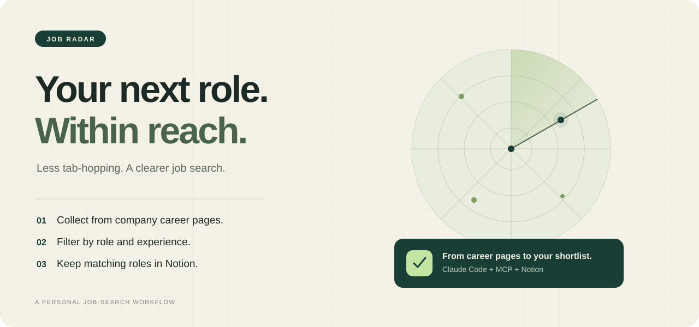

<p align="center">
  
</p>

<h1 align="center">Job Radar</h1>

<p align="center">
  <em>찾는 건 공고가 아니라, 나에게 맞는 다음 기회.</em>
</p>

<p align="center">
  
  <a href="pyproject.toml"></a>
  <a href="server.py"></a>
  <a href="LICENSE"></a>
</p>

<p align="center">
  
</p>

<p align="center">
  <strong>흩어진 채용 공고를 모아, 나에게 맞는 공고만 Notion에.</strong><br>
  <sub>기업 채용 페이지 수집 · 직무와 경력 필터링 · 중복 확인 · 마감 공고 정리</sub>
</p>

<p align="center">
  <a href="#install">설치</a> · <a href="#usage">사용법</a> · <a href="#how-it-works">작동 방식</a> · <a href="#sources">수집 출처</a> · <a href="#contribute">기여</a>
</p>

---

채용 페이지를 열고, 직무가 맞는지 확인하고, 요구 경력을 읽고, 링크를 복사합니다. 다음 회사에서도 같은 일을 반복합니다.

Job Radar는 그 과정을 **Claude Code 스킬과 MCP 서버**로 연결합니다. MCP 서버가 기업 채용 페이지에서 공고를 가져오고, Claude가 직무와 자격 요건을 살펴 Notion DB에 정리합니다.

## 공고 탐색에서 지원 준비로

| 매번 하던 일 | Job Radar를 쓰면 |
| --- | --- |
| 기업 채용 페이지를 하나씩 방문하기 | 등록한 출처에서 공고를 모읍니다. |
| 제목과 자격 요건을 읽어 후보 고르기 | 키워드·연차로 1차 필터링하고 Claude가 다시 판단합니다. |
| 이미 본 공고인지 확인하고 링크 저장하기 | 링크와 회사·제목을 비교해 새 공고를 Notion에 기록합니다. |
| 마감된 공고를 찾아 정리하기 | 실행할 때 마감일이 지난 공고를 DB에서 삭제합니다. |

> [!IMPORTANT]
> 실행 시 연결한 Notion DB에서 **마감일이 오늘 이전인 공고를 삭제**합니다. 마감일이 없는 공고는 유지합니다. 지원 이력을 보관하는 DB를 연결한다면 이 동작을 먼저 확인하세요.

<a id="install"></a>

## 설치

[Claude Code](https://claude.com/claude-code), [uv](https://docs.astral.sh/uv/), Python 3.11 이상, Notion 계정이 필요합니다.

**1. Claude Code에서 아래 명령을 각각 실행합니다.**

```text
/plugin marketplace add KIMDONGWOOK12/job-radar
```

```text
/plugin install job-radar@job-radar
```

스킬과 MCP 서버가 함께 설치됩니다. 설치 후 Claude Code를 다시 시작하세요.

**2. Notion을 연결합니다.**

claude.ai 설정의 커넥터에서 Notion을 연결하고 Claude Code에도 같은 계정으로 로그인하세요. 또는 터미널에서 Notion MCP를 등록할 수 있습니다.

```bash
claude mcp add --transport http notion https://mcp.notion.com/mcp
```

Claude Code의 `/mcp`에서 인증하고, 공고를 저장할 페이지에 접근할 수 있는지 확인하세요.

<details>
<summary>플러그인 없이 직접 설치하기</summary>

```bash
git clone https://github.com/KIMDONGWOOK12/job-radar.git
cd job-radar
uv sync
claude mcp add job-radar -s user -- uv run --directory "$(pwd)" server.py
mkdir -p ~/.claude/skills
ln -s "$(pwd)/skills/job-radar" ~/.claude/skills/job-radar
```

직접 설치한 스킬은 `/job-radar`로 실행합니다. Notion 연결은 별도로 필요합니다. 이미 같은 이름의 MCP 서버나 스킬이 등록되어 있다면 기존 설정을 먼저 확인하세요.

</details>

<a id="usage"></a>

## 사용법

Claude Code에서 실행하세요.

```text
/job-radar:job-radar
```

또는 **“채용 공고 업데이트해줘”**라고 말해도 됩니다.

처음 실행하면 원하는 직무, 연차(신입은 `0`), 기업 분류, 제외 조건을 묻습니다. 답변에 맞는 검색 키워드를 제안하고 확인받은 뒤, 저장할 Notion DB를 선택합니다. DB가 없으면 생성할 위치를 물어보고 새로 만듭니다.

설정은 `~/.job-radar/profile.yaml`에 저장되며, 이후 실행부터 다시 사용합니다.

| 하고 싶은 일 | 입력 |
| --- | --- |
| 공고 수집·정리 | `/job-radar:job-radar` 또는 “채용 공고 업데이트해줘” |
| 직무·연차·제외 조건 변경 | “job-radar 설정 바꿔줘” |

<details>
<summary>개인 설정 예시 보기</summary>

```yaml
roles: "백엔드 개발, 서버"
keywords: [백엔드, Backend, 서버, Server]
exclude_keywords: [Staff, Principal, Lead, 시니어]
max_career: 1
avoid: "계약직, 지방 근무"
categories: [대기업, 대기업 계열사, 중견기업]
notion_data_source: "<data source ID>"
```

`max_career`는 허용할 최소 요구 경력의 상한입니다. 예를 들어 `1`이면 최소 요구 경력이 1년 이하인 공고를 후보로 남깁니다. 경력 정보가 불명확한 공고는 본문 확인을 시도합니다.

</details>

<a id="how-it-works"></a>

## 작동 방식

1. **설정 읽기** — 원하는 직무와 연차, 기업 분류, 제외 조건을 불러옵니다.
2. **마감 공고 정리** — Notion DB에서 마감일이 지난 공고를 삭제합니다.
3. **공고 모으기** — 기업 채용 페이지에서 수집하고 키워드·연차로 1차 필터링합니다.
4. **조건 확인하기** — Claude가 직무를 판단하고, 필요한 경우 본문에서 경력 조건을 확인합니다.
5. **Notion에 기록하기** — 중복을 확인해 새 공고를 넣고, 추가·삭제 건수와 수집 실패를 보고합니다.

Notion에는 회사·공고명, 직무, 경력, 마감일, 근무지와 공식 지원 링크 등을 기록합니다. 지원 전에는 원문에서 자격 요건과 마감일을 다시 확인하세요.

실행은 사용자의 요청으로 시작됩니다. **플러그인 자체에 주기 실행 스케줄러는 포함되어 있지 않습니다.**

<a id="sources"></a>

## 수집 출처

[`companies.yaml`](companies.yaml)에 **115개 수집 대상 항목**이 등록되어 있습니다. 기업별 채용 페이지와 잡알리오 같은 통합 출처가 함께 포함된 수치이며, 모든 항목의 실시간 수집 성공을 뜻하지 않습니다.

| 수집 방식 | 출처 |
| --- | --- |
| 전용 수집기 | 삼성, CJ, 네이버, 카카오, 토스, 잡알리오 |
| 채용 플랫폼 기반 | Greenhouse, 그리팅, 마이다스 (`recruiter.co.kr`) |
| 페이지 확인 시도 | `custom`으로 등록된 채용 페이지를 Claude가 WebFetch로 확인 |

마이다스, 삼성, 그리팅, Greenhouse 계열은 `get_job_detail`로 본문 확인을 시도합니다. 이 도구가 지원하지 않는 출처는 WebFetch로 확인합니다.

**현재 한계:** 사이트 구조 변경, 접근 차단, 이미지로 된 본문 때문에 수집이나 조건 확인에 실패할 수 있습니다. SK·LG·현대자동차그룹의 채용 페이지는 현재 코드 수집 대상이 아니며 직접 확인해야 합니다.

## 회사 추가

[`companies.yaml`](companies.yaml)의 `companies` 목록에 항목을 추가하세요.

```yaml
# 예시입니다. 실제 회사명과 채용 페이지 호스트로 바꿔 주세요.
- {name: 회사명, category: 중견기업, source: greeting, id: example.career.greetinghr.com}
```

| `source` | 필요한 값 |
| --- | --- |
| `greeting` | `id`: 그리팅 채용 페이지 호스트 |
| `greenhouse` | `id`: Greenhouse 보드 이름 |
| `recruiter` | `id`: 마이다스 채용 페이지 호스트 |
| `custom` | `url`: Claude가 직접 확인을 시도할 채용 페이지 |

기업 분류는 `대기업`, `대기업 계열사`, `중견기업`, `강소·유망`, `공기업`, `외국계` 중에서 지정합니다.

## 내부 구성

```text
job-radar/
├── .claude-plugin/          플러그인·마켓플레이스 설정
├── .mcp.json                MCP 서버 실행 설정
├── server.py                공고 수집·검색·본문 확인
├── companies.yaml           수집 대상과 출처
├── assets/                  README 이미지
└── skills/job-radar/
    └── SKILL.md             설정·필터링·Notion 저장 절차
```

| MCP 도구 | 역할 |
| --- | --- |
| `search_jobs` | 여러 출처에서 공고를 수집하고 키워드·경력·기업 분류로 필터링 |
| `get_job_detail` | 지원하는 출처에서 공고 본문과 자격 요건 확인 |
| `fetch_jobs` | 지정한 회사 하나의 공고 수집 |
| `list_companies` | 등록된 수집 대상 목록 조회 |

## 자주 묻는 질문

**매일 자동으로 실행되나요?**

자체 스케줄러는 없습니다. 사용할 때 수집 명령을 실행하세요. 별도의 예약 실행 환경을 연결한다면 최초 사용자 설정을 먼저 마쳐야 합니다.

**왜 일부 회사의 공고가 빠지나요?**

채용 페이지 접근 제한이나 구조 변경이 원인일 수 있습니다. 실행 후 보고되는 수집 실패와 확인하지 못한 페이지를 살펴보고, 해당 기업의 채용 사이트를 직접 확인하세요.

**Notion에 저장되지 않아요.**

Claude Code의 `/mcp`에서 Notion 인증 상태를 확인하세요. 연결된 계정에 대상 페이지와 DB 접근 권한이 필요합니다.

**명령어가 보이지 않아요.**

설치 후 Claude Code를 다시 시작하세요. 플러그인 설치 시에는 `/job-radar:job-radar`, 직접 설치 시에는 `/job-radar`를 사용합니다.

<a id="contribute"></a>

## 기여

누락된 기업, 바뀐 채용 페이지, 수집 오류를 발견했다면 [원본 저장소의 이슈](https://github.com/KIMDONGWOOK12/job-radar/issues)나 Pull Request로 알려 주세요. 수집 오류에는 회사명, 채용 페이지 링크와 오류 내용을 함께 적어 주시면 도움이 됩니다.

새 출처를 추가할 때는 해당 사이트의 이용 조건과 접근 정책을 확인해 주세요.

## 만든 사람

[@KIMDONGWOOK12](https://github.com/KIMDONGWOOK12) · [@SWHee](https://github.com/SWHee)

## 라이선스

[MIT](LICENSE).
